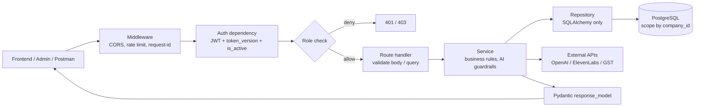
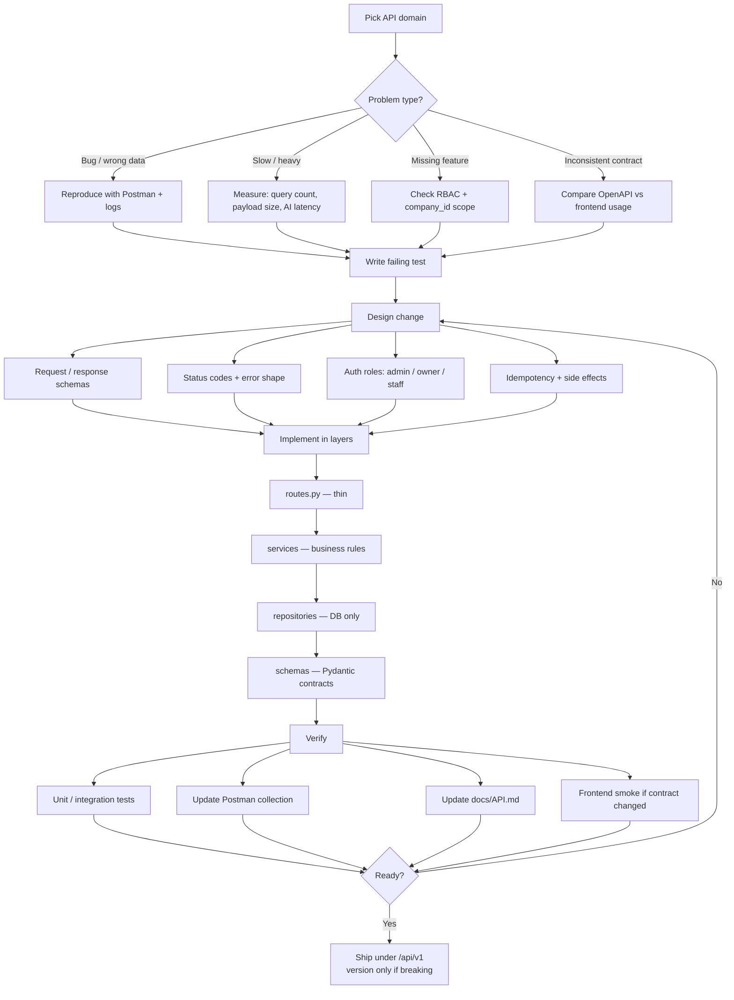
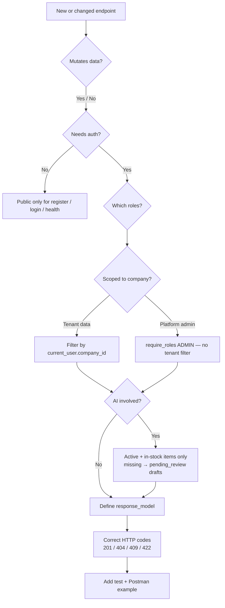
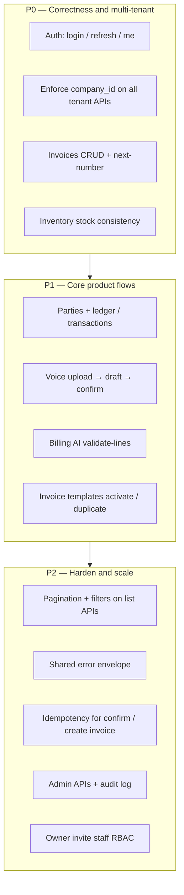

# API Improvement Guide — Backend Team

**Product:** Inventory AI System / SmartBill AI  
**Audience:** Backend developers  
**Base URL:** `http://localhost:8000/api/v1`  
**Stack:** FastAPI · SQLAlchemy · PostgreSQL · JWT · OpenAI / ElevenLabs  
**Related docs:** [API.md](./API.md) · [RBAC_ROADMAP.md](./RBAC_ROADMAP.md) · [Postman collection](./postman_collection.json)

---

## 1. Purpose

This document defines **how we improve APIs** in this repo: process, architecture, priorities, and acceptance criteria. Use it when designing new endpoints, refactoring existing ones, or reviewing PRs.

**Goals**

- Stable, typed contracts for the Next.js frontend and Streamlit admin portal
- Correct multi-tenant isolation (`company_id`)
- Safe AI / voice billing (guardrails)
- Clear errors, predictable status codes, and documented OpenAPI

---

## 2. Current API surface (modules)

| Domain | Prefix | Code location | Notes |
|--------|--------|---------------|--------|
| Auth | `/auth/*` | `backend/app/api/router.py` | register, login, refresh, me |
| Inventory | `/inventory/*` | `backend/app/inventory/` | items, brands, categories, catalog bulk |
| Retail billing helpers | `/billing/*` | `backend/app/billing/` | AI validate lines, stock update, business info |
| Invoices | `/invoices/*` | `backend/app/reports/` | CRUD + next invoice number |
| Parties | `/parties/*` | `backend/app/customers/` | customers/suppliers, ledger, transactions |
| Invoice templates | `/invoice-templates/*` | `backend/app/purchase_invoice/` | CRUD, duplicate, activate |
| Voice / AI drafts | `/voice/*` | `backend/app/voice/` | upload → draft → confirm / cancel |
| Company settings | `/companies/*` | `backend/app/companies/` | tenant settings |
| User settings | `/users/me/*` | `backend/app/users/` | profile, change password |
| GST lookup | `/gst/*` | `backend/app/gst/` | GSTIN lookup |
| Platform admin | `/admin/*` | `backend/app/admin/` | admin role only |

Health (no `/api/v1` prefix): `GET /health`

---

## 3. Target architecture (request path)

Every authenticated business API should follow this path. Keep **routes thin**.



### Layer responsibilities

| Layer | Responsibility | Must not |
|-------|----------------|----------|
| **Route** | Auth deps, parse input, call service, return schema | Contain business rules or raw SQL |
| **Service** | Stock rules, GST, invoice numbering, AI guardrails, transactions | Know about HTTP Request objects |
| **Repository** | Queries / persistence for one aggregate | Call OpenAI or enforce HTTP status |
| **Schema** | Request/response contracts (`response_model`) | Leak ORM models to clients |

---

## 4. End-to-end improvement workflow

Use this flow for bugs, performance work, new features, and contract cleanup.



---

## 5. Per-endpoint decision checklist

Before merging any new or changed endpoint:



### Checklist (copy into PR)

- [ ] `response_model` set; no raw ORM returned
- [ ] Auth via `get_current_user` / `require_roles(...)` as appropriate
- [ ] All tenant reads/writes filtered by `company_id` (except platform `/admin`)
- [ ] Public register always creates **owner** + new company (never `admin`)
- [ ] AI paths respect guardrails (see §7)
- [ ] Correct status codes; consistent error `detail`
- [ ] Tests added/updated
- [ ] `docs/API.md` and Postman updated if contract changed
- [ ] Breaking changes discussed (prefer additive fields; avoid silent renames)

---

## 6. Priority roadmap for API work



### Suggested backlog items

| Priority | Work item | Why |
|----------|-----------|-----|
| P0 | Audit every list/get/update for `company_id` | Prevent cross-tenant data leaks |
| P0 | Invoice create + stock decrement in one DB transaction | Avoid stock/invoice mismatch |
| P0 | Align `/billing` vs `/invoices` naming in docs and tags | Reduce frontend confusion |
| P1 | Voice draft state machine (draft → confirmed / cancelled) | Clear AI billing lifecycle |
| P1 | Timeouts / fallbacks for STT and extraction | Predictable UX when AI is slow |
| P1 | Party GSTIN uniqueness → clear `409` messages | Better UI error handling |
| P2 | Cursor or page-based pagination on items, parties, invoices, admin lists | Scale |
| P2 | Standard error body: `{ "code", "message", "details?" }` | Consistent clients |
| P2 | Idempotency-Key on `POST /invoices` and `POST /voice/drafts/{id}/confirm` | Safe retries |
| P2 | Owner staff invite APIs (see RBAC roadmap) | Multi-user tenants |

---

## 7. Business rules that APIs must enforce

### AI / voice billing guardrails

- AI may create bill lines **only** for items that already exist, are **active**, and have sufficient stock.
- Missing items may be created only as **draft / pending_review** records — not auto-sold.
- Confirming a draft is an explicit user action; do not silently finalize.
- Manual stock edits use dedicated endpoints (e.g. billing manual update) — not hidden side effects.

### Auth and RBAC

| Role | Scope |
|------|--------|
| `admin` | Platform-wide (`/admin/*` only for privileged ops) |
| `owner` | Default on public register; company operations |
| `manager` / `accountant` / `sales_staff` / `store_operator` | Company staff (invite flows planned) |

Rules:

- Do **not** assign `admin` on public register.
- Force-logout bumps `users.token_version` (invalidates JWTs).
- Disabled users → `403`.

See [RBAC_ROADMAP.md](./RBAC_ROADMAP.md) for planned owner-invite and tenant-scoped permissions.

### Multi-tenancy

- Tenant entities (items, parties, invoices, templates, drafts, company settings) must be scoped to `current_user.company_id`.
- Never trust `company_id` from the request body for authorization; derive from the authenticated user (except platform admin tools).

---

## 8. HTTP and contract conventions

| Situation | Status |
|-----------|--------|
| Created resource | `201` |
| Success, no body needed | `204` or `200` with message schema |
| Validation error | `422` (FastAPI default) |
| Bad credentials / bad token | `401` |
| Authenticated but forbidden | `403` |
| Missing resource (or hide cross-tenant) | `404` |
| Duplicate email / GSTIN / code | `409` |

**Conventions**

- Prefer plural resource paths: `/invoices`, `/parties`, `/inventory/items`.
- Use UUIDs in path params where the schema already uses UUID.
- List endpoints should eventually support: `limit`, `offset` (or cursor), and domain filters (`status`, `search`, `role`).
- Keep OpenAPI accurate: every public route has `response_model` and documented errors where useful.
- Additive response fields are OK; renaming/removing fields requires frontend coordination.

**Proposed shared error shape (P2)**

```json
{
  "code": "STOCK_INSUFFICIENT",
  "message": "Requested quantity exceeds available stock.",
  "details": { "item_code": "ITM-SAMSUNG-S25U", "available": 2 }
}
```

Until adopted, keep `detail` strings clear and stable enough for the UI.

---

## 9. Domain-specific guidance

### Auth (`/auth`)

- Login/register return access + refresh tokens.
- Refresh must validate `type == refresh` and `token_version`.
- `/auth/me` should remain the source of truth for role + company profile summary.

### Inventory (`/inventory`)

- Creating items must not break unique `item_code` / SKU constraints — return `409`.
- Stock changes from billing/voice must go through services with row locks or equivalent safety.
- Prefer `GET /inventory/items/{id}` if missing (frontend often needs single-item fetch).

### Invoices (`/invoices`) + billing (`/billing`)

- Next invoice number must be concurrency-safe (no duplicate numbers under parallel creates).
- AI validate-lines is advisory + guardrail; final persist is invoice/draft confirm.
- Document which endpoint the UI should call for “create bill” vs “validate AI lines”.

### Voice (`/voice`)

Recommended state flow:

```text
upload → (transcript) → draft created → user review/edit → confirm | cancel
```

- Confirm should be idempotent or reject double-confirm with a clear error.
- Cap upload size (`VOICE_MAX_UPLOAD_MB`); rate-limit uploads.
- Do not return internal provider stack traces to the client.

### Parties (`/parties`)

- Ledger and transactions must match invoice/payment postings.
- GSTIN uniqueness errors should be explicit (`409`).

### Admin (`/admin`)

- Strictly `admin` role.
- Prefer audit-friendly mutations (who disabled whom, when).
- Do not expose password hashes or secrets in list/detail responses.

---

## 10. Testing and delivery expectations

For each non-trivial API change:

1. **Local:** run API with `uvicorn app.main:app --reload --port 8000`
2. **Verify:** hit `/docs` and exercise the endpoint in Postman
3. **Automate:** add or update tests under `backend/app/tests` (or existing script patterns)
4. **Document:** update `docs/API.md` + `docs/postman_collection.json`
5. **Coordinate:** if response shape changes, notify frontend (and admin portal if `/admin`)

### Local credentials (dev seed)

| Email | Password | Role |
|-------|----------|------|
| `admin@blulabs.in` | `Admin@12345` | platform admin |

Do not use production secrets in examples. OpenAI / ElevenLabs keys stay in `backend/.env` only.

---

## 11. Definition of Done (API change)

An API task is done when:

1. Behavior matches the product rule (especially AI guardrails and tenant scope)
2. Contract is typed and visible in OpenAPI
3. Auth/RBAC is correct
4. Tests cover happy path + at least one failure path (401/403/404/409 as relevant)
5. Docs and Postman are updated
6. No cross-tenant data access in manual or automated checks

---

## 12. Quick reference — where to edit

```text
backend/app/
  api/router.py          # auth + router includes
  auth/dependencies.py   # JWT, require_roles, admin checks
  */routes.py            # HTTP endpoints
  */services/ or services/   # business logic
  repositories/          # DB access
  schemas/               # Pydantic models
  models/                # SQLAlchemy models
```

---

## 13. Contact / ownership (fill in)

| Area | Owner |
|------|--------|
| Auth / RBAC | _TBD_ |
| Inventory / stock | _TBD_ |
| Invoices / billing | _TBD_ |
| Voice / AI | _TBD_ |
| Admin portal APIs | _TBD_ |

---

*This guide is the working agreement for backend API improvements. Prefer small, reviewable PRs that follow the workflow in §4 and the Definition of Done in §11.*
